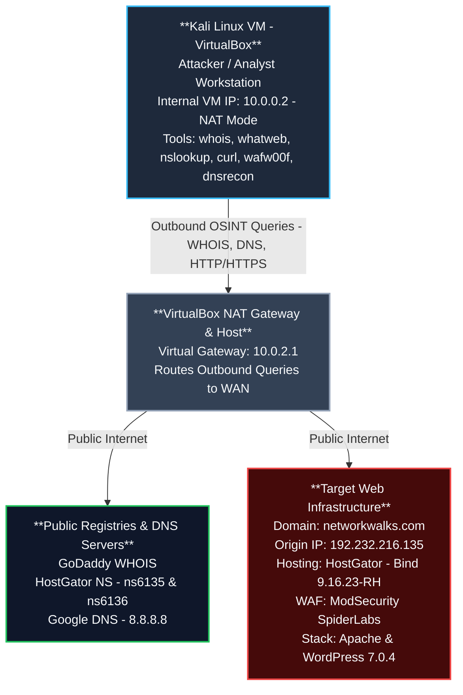

# NETWORKWALKS-B084-WK2-PM1-FOOTPRINTING-AND-RECONNAISSANCE


<div align="center">

#  🔍 Ethical Hacking Lab: Footprinting & Reconnaissance

**Gathering Domain, DNS, Web Stack & WAF Intelligence with Kali Linux Tools**
</div>

<p align="center">


   


---

## 📋 Project Overview
**Reconnaissance (Footprinting)** is the critical first phase of any ethical hacking engagement or penetration test. Before interacting directly with a target system, a security analyst quietly collects publicly available intelligence to map out domain ownership, hosting infrastructure, DNS/mail routing, web technologies, and perimeter defenses without triggering alerts on the target system.

In this lab (**Week 2 | Project Module 1**), six built-in **Kali Linux** reconnaissance utilities were executed against `networkwalks.com` to build a comprehensive intelligence profile of the target:
1. `whois` — Domain registration & registrar intelligence
2. `whatweb` — Web technology & CMS fingerprinting
3. `nslookup` — DNS-to-IP address resolution
4. `curl` — HTTP response header inspection
5. `wafw00f` — Web Application Firewall (WAF) detection
6. `dnsrecon` — Comprehensive DNS record enumeration

---

## 🎯 Objectives
* **Gather Domain & Ownership Intelligence:** Query public WHOIS records to identify domain registration details, expiration timelines, and authoritative name servers (`whois`).
* **Enumerate DNS Infrastructure:** Resolve the target domain to its origin IPv4 address and map all DNS records (`A`, `NS`, `MX`, `SPF`, `TXT`, and `SRV`) using `nslookup` and `dnsrecon`.
* **Fingerprint Web Technologies & Headers:** Identify the underlying web server, CMS version, active plugins, frameworks, and HTTP response headers using `whatweb` and `curl -I`.
* **Detect Perimeter Defenses:** Probe the target web application to identify Web Application Firewall (WAF) protections using `wafw00f`.

---

## 💡 Purpose of the Lab
The purpose of this laboratory is to practice the **reconnaissance (footprinting) phase** of an ethical hacking engagement—the critical first step before any active vulnerability scanning or exploitation takes place. Using only publicly accessible records and standard protocol queries, this lab demonstrates how an analyst builds a complete technical profile of a target (`networkwalks.com`) without directly attacking it, and explains how organizations can reduce public metadata leakage to strengthen their security posture.

---

## 🏗️ Lab Architecture & Network Topology
The reconnaissance workflow operates from an isolated **Kali Linux** workstation querying public internet infrastructure and the authorized target web server:




### Topology Flow Breakdown
1. **Analyst Workstation (Kali Linux):** Initiates all six reconnaissance commands from an isolated VirtualBox VM configured in **NAT mode (`10.0.0.2`)**.
2. **Public Registries & DNS Layer:** `whois`, `nslookup`, and `dnsrecon` query public registrar databases (GoDaddy) and authoritative name servers (`://hostgator.com`, `://hostgator.com`) to map domain ownership, mail servers, and cPanel `SRV` records.
3. **Target Web Layer (`192.232.216.135`):** `whatweb`, `curl -I`, and `wafw00f` send standard HTTP/HTTPS requests through the **ModSecurity WAF** to inspect server headers, API endpoints (`/wp-json/`), and CMS versions (`WordPress 7.0.4`).


## 🛠️ Lab Tasks, Commands & Intelligence Findings

### Task 1: Domain Registration & WHOIS Intelligence
* **Objective:** Query public WHOIS records to identify domain ownership, registration/expiration dates, registrar details, and authoritative name servers.
* **Command Executed:**
  ```bash
  whois networkwalks.com
  ```


* **Observed Findings:**
  * **Domain Name & Registry ID:** `NETWORKWALKS.COM` (`2452319255_DOMAIN_COM-VRSN`)
  * **Registrar & IANA ID:** `GoDaddy.com, LLC` (`IANA ID: 146`) | WHOIS Server: `://godaddy.com`
  * **Key Dates:** Created `2019-11-06T22:51:46Z` | Updated `2025-11-12T10:08:43Z` | Expires `2027-11-06T22:51:46Z`
  * **Authoritative Name Servers:** `://hostgator.com` and `://hostgator.com`
  * **Domain Status & DNSSEC:** `clientDeleteProhibited`, `clientRenewProhibited`, `clientTransferProhibited`, `clientUpdateProhibited` | `DNSSEC: unsigned`
  * **Abuse Contacts:** `abuse@godaddy.com` | Phone: `480-624-2505`
* **Attacker Perspective:** Name servers (`://hostgator.com` and `://hostgator.com`) confirm **HostGator** as the underlying hosting provider, while `DNSSEC: unsigned` indicates DNS responses are not cryptographically signed, and registrar details assist in infrastructure profiling.

---

### Task 2: Web Technology Fingerprinting
* **Objective:** Identify the web server, Content Management System (CMS), active plugins, frontend frameworks, and server IP.
* **Command Executed:**
  ```bash
  whatweb networkwalks.com
  ```


* **Observed Findings:**
  * **HTTP vs. HTTPS Behavior:** Plain HTTP (`http://networkwalks.com`) returned `ERROR Opening: Connection reset by peer`, while HTTPS (`https://networkwalks.com`) returned `[200 OK]`
  * **Web Server & Hosting Location:** `Apache` | `UNITED STATES [US]` (`192.232.216.135`)
  * **Page Title & Metadata:** `Networkwalks Academy` | `Open-Graph-Protocol [website]`
  * **CMS & Plugins:** **WordPress 7.1.4**, **WordPress Download Manager 3.3.76**
  * **Frameworks, Libraries & Analytics:** `Bootstrap`, `JQuery`, `HTML5`, `Google-Tag-Manager`
  * **Cookies & Uncommon Headers:** `__wpdm_client` (`HttpOnly`), `permissions-policy`, `link`, `referrer-policy`, `x-endurance-cache-level`, `x-nginx-cache`
  * **Exposed Contact:** `info@networkwalks.com`
* **Attacker Perspective:** Exposing exact software and plugin versions (**WordPress 7.1.4** and **WordPress Download Manager 3.3.76**) alongside an administrative email address enables attackers to query CVE databases for version-specific exploits and craft targeted phishing campaigns.


---

### Task 3: DNS Resolution (`nslookup`)
* **Objective:** Resolve the target domain name into its underlying IPv4 address via DNS.
* **Command Executed:**
  ```bash
  nslookup networkwalks.com
  ```


* * **Observed Findings:**
  * **DNS Resolver Used:** `192.168.0.1` (`192.168.0.1#53`)
  * **Query Answer Type:** `Non-authoritative answer`
  * **Queried Domain:** `networkwalks.com`
  * **Resolved IPv4 Address:** `192.232.216.135`
* **Attacker Perspective:** Resolving the origin IP (`192.232.216.135`) allows an attacker to perform direct port scanning, run reverse-IP lookups to find co-hosted domains, and map network boundaries.

---

### Task 4: HTTP Response Header Inspection
* **Objective:** Inspect raw HTTP response headers to analyze server banners, caching layers, cookies, and hidden endpoints.
* **Command Executed:**
  ```bash
  curl -I https://networkwalks.com
  ```


** **Observed Findings:**
  * **HTTP Status:** `HTTP/1.1 200 OK`
  * **Timestamp & Content Type:** `Date: Sat, 14 Nov 2026 09:10:17 GMT` | `Content-Type: text/html; charset=UTF-8`
  * **Server & Caching Stack:** `Server: Apache`, `X-nginx-cache: WordPress`, `X-Endurance-Cache-Level: 0`
  * **Exposed API Endpoints:** `<https://networkwalks.com/wp-json/>; rel="https://api.w.org/"` and `<https://networkwalks.com/wp-json/wp/v2/pages/53>; rel="alternate"; title="JSON"; type="application/json"` (WordPress REST API)
  * **Cookies & Security Headers:** `Set-Cookie: __wpdm_client=...; path=/; domain=networkwalks.com; secure; HttpOnly`, `Permissions-Policy` (referencing Google, Cloudflare, and hCaptcha), and `Referrer-Policy: no-referrer-when-downgrade`
* **Attacker Perspective:** HTTP headers reveal backend server architecture, caching configurations, active plugins (`__wpdm_client` from WP Download Manager), and WordPress REST API endpoints without requiring full page rendering.
 

---

### Task 5: Web Application Firewall (WAF) Detection
* **Objective:** Determine whether a Web Application Firewall is actively filtering traffic to the target site.
* **Command Executed:**
  ```bash
  wafw00f networkwalks.com
  ```


* * **Observed Findings:**
  * **Tool & Version:** `WAFW00F v2.4.2`
  * **Target Checked:** `https://networkwalks.com`
  * **WAF Identified:** **ModSecurity (SpiderLabs)** (`[+] The site https://networkwalks.com is behind ModSecurity (SpiderLabs) WAF.`)
  * **Probe Count:** `2` requests sent
* **Attacker Perspective:** Confirming that **ModSecurity (SpiderLabs)** is active with only 2 probes tells the tester that noisy or generic attack payloads will be blocked or logged, shaping subsequent evasion or testing strategies.

---

### Task 6: Comprehensive DNS Enumeration
* **Objective:** Enumerate all DNS record types including `SOA`, `NS`, `MX`, `SPF`/`TXT`, and Service (`SRV`) records.
* **Command Executed:**
  ```bash
  dnsrecon -d networkwalks.com
  ```


* * **Observed Findings:**
  * **DNSSEC Status:** `No answer for DNSSEC query for networkwalks.com` (DNSSEC not enabled)
  * **SOA & Name Servers (`NS`):** `ns6135.hostgator.com` (`50.87.144.87`) and `ns6136.hostgator.com` (`192.232.216.131`)
  * **DNS Server Banner:** `Bind Version: "9.16.23-RH"` (exposed on both `50.87.144.87` and `192.232.216.131`)
  * **Address (`A`) & Mail Exchange (`MX`):** `networkwalks.com` (`192.232.216.135`) and `mail.networkwalks.com` (`192.232.216.135`)
  * **TXT / SPF Records:** `v=spf1 +a +mx +ip4:50.87.144.87 +include:websitewelcome.com ~all` and `google-site-verification=rr04eRmqHoWY3XemnizDNVK4q75X-Ij-mjgEeg-UsYI`
  * **Service (`SRV`) Records (`8 Records Found`):** Multiple `_autodiscover._tcp.networkwalks.com` records pointing to `cpanelemaildiscovery.cpanel.net` across `184.94.203.x` and `184.94.204.x` on port `443`
* **Attacker Perspective:** Maps the target's entire DNS, email routing, and cPanel hosting infrastructure while revealing the exact DNS server software version (`Bind 9.16.23-RH`) and unconfigured DNSSEC posture.

---

## 🛡️ Defensive Takeaways & Hardening Recommendations
* **Why Footprinting Matters:** Passive reconnaissance relies solely on publicly accessible data, making it virtually undetectable. The less technical metadata an organization leaks, the harder every subsequent stage of an attack becomes.
* **Key Mitigations:**
  * Suppress server banners (`Apache`, `Bind` versions) and CMS/plugin generator tags.
  * Keep WordPress core and plugins (such as WP Download Manager) patched against known vulnerabilities.
  * Restrict unauthenticated access to `/wp-json/` endpoints if not required by public users.
  * Regularly audit public DNS records and keep **ModSecurity WAF** rules updated and monitored.

---

## 📂 Repository Structure
```text
├── README.md
└── screenshots/
    ├── 1_whois.png
    ├── 2_whatweb.png
    ├── 3_nslookup.png
    ├── 4_curl.png
    ├── 5_wafw00f.png
    └── 6_dnsrecon.png
```

---

## 🔐 Security & Ethical Use
This laboratory and repository are intended strictly for educational and authorized research purposes only. All reconnaissance activities were conducted within the authorized [NetworkWalks](https://networkwalks.com) lab scope. Unauthorized scanning or exploitation of external systems is illegal.

## 🔗 Tools & Resources
* **Primary Environment:** Kali Linux Workstation ([NetworkWalks](https://networkwalks.com) Week 2 | Project Module 1)
* **Reconnaissance Suite:** `whois`, `whatweb`, `nslookup`, `curl`, `wafw00f`, `dnsrecon`
* **Official Documentation:** [Kali Linux Tools Reference](https://kali.org)

## 👤 Author
**Anderson Edaiyo Uzezi**  
Cybersecurity Professional B084  
LinkedIn: https://linkedin.com

   


